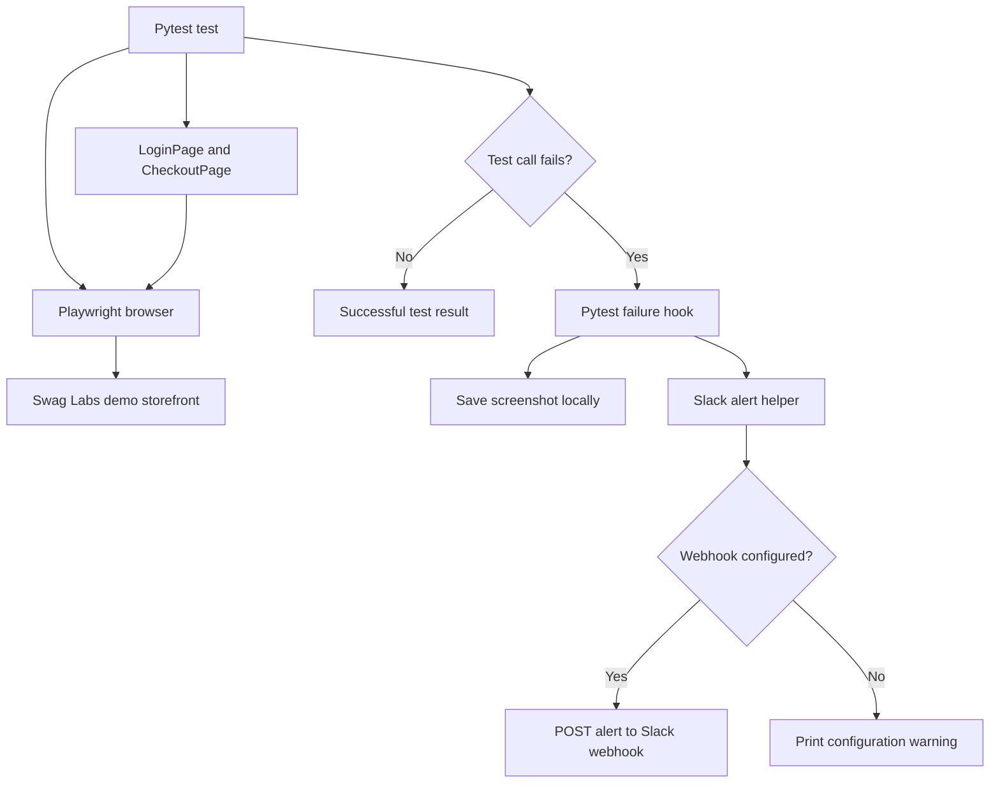
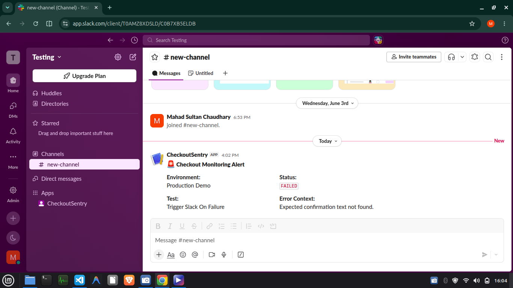

# Checkout Sentry

Checkout Sentry is a Python checkout-test demo that uses Playwright and Pytest to automate a Swag Labs storefront flow and send a Slack webhook alert when a test fails.

## Watch the Demo

[](https://youtu.be/A25-7svYsNo)

Watch the demonstration to see an automated checkout flow, a deliberately simulated test failure, a Slack alert with failure context, and a successful checkout test.

## Problem and solution

Checkout flows are important to e-commerce applications, and browser tests can check that a defined flow behaves as expected. Checkout Sentry demonstrates one repeatable checkout scenario and a failure-notification path; it is a test automation example, not a service continuously monitoring a live store.

## What the Demo Shows

- **00:00–00:06 — Alert destination:** A Slack test channel is visible beside the development workspace.
- **00:07–00:14 — Test execution:** VS Code runs `pytest tests/test_checkout_failure.py`, and Chromium opens the Swag Labs demo storefront.
- **00:15–00:25 — Checkout automation:** The test prepares the run, adds the Sauce Labs Backpack to the cart, opens the cart, and fills in the checkout information.
- **00:26–00:34 — Checkout completion:** The order overview and checkout completion screen appear.
- **00:35–00:43 — Failure notification:** The test deliberately expects confirmation text that is not present, producing a simulated assertion failure. A Slack webhook sends a Checkout Monitoring Alert with failure status, test name, and error context. This is a test failure created for the demonstration; it does not indicate that a live customer transaction failed.
- **00:44–00:54 — Successful test run:** The terminal executes `pytest tests/test_checkout.py`, demonstrating a successful test run.

## Features

- Playwright browser automation for a single Swag Labs checkout flow.
- Pytest tests for a successful checkout and a deliberately failing assertion.
- Page Object Model classes for login and checkout page interactions.
- A Pytest hook that captures a local screenshot when a test's call phase fails and attempts a Slack webhook notification.
- Headed and headless test execution.

## Architecture



The failure hook runs only for failures during the test call phase. The demo failure is intentionally triggered by an incorrect assertion after checkout completes; the alert is a test notification, not a live-store monitoring signal.

## How it works

1. The browser test logs in to the Swag Labs demo site, adds the Sauce Labs Backpack to the cart, and completes checkout.
2. Pytest and Playwright assertions check the expected confirmation message, URL, and empty cart in the successful test.
3. In the failure demonstration, an assertion expects `Order Failed` instead of the storefront's `Thank you for your order!` confirmation. The failure hook saves a screenshot and invokes the Slack webhook helper.
4. A separate successful test run exercises the normal path.

The Page Object Model keeps login and checkout interactions in `pages/login_page.py` and `pages/checkout_page.py`; tests are in `tests/`. The Slack helper in `utils/slack_helper.py` posts a fixed alert payload containing a test name, `FAILED` status, and the message `Expected confirmation text not found.` The screenshot is saved locally under `screenshots/`; its path is not included in the Slack message.

## Technology stack

- Python
- Playwright and Pytest (including the `pytest-playwright` fixture)
- Requests
- `python-dotenv`
- Slack incoming webhook

## Installation and setup

Clone the repository and create an environment:

```bash
git clone https://github.com/mahadsultanchaudhary/checkout_sentry.git
cd checkout_sentry
python -m venv venv
```

Activate it:

```bash
# Linux / macOS
source venv/bin/activate

# Windows
venv\Scripts\activate
```

Install the packages used by the project and Chromium:

```bash
pip install playwright pytest pytest-playwright requests python-dotenv
playwright install chromium
```

To receive Slack notifications, create a `.env` file in the project root:

```env
SLACK_WEBHOOK_URL=https://hooks.slack.com/services/YOUR/WEBHOOK/URL
```

The `.env` file is listed in `.gitignore`. If `SLACK_WEBHOOK_URL` is unset, the helper prints a warning and skips sending the notification.

## Run the tests

Successful checkout:

```bash
pytest tests/test_checkout.py
```

Deliberately failing test (invokes the failure hook):

```bash
pytest tests/test_checkout_failure.py
```

To see the browser while running either test, add `--headed --slowmo 1000`, for example:

```bash
pytest tests/test_checkout.py --headed --slowmo 1000
```

The tests navigate to `https://www.saucedemo.com/` and therefore require access to that demo site.

## Example failure output and Slack alert

The failure test completes the storefront checkout, then fails on the intentionally incorrect expected heading:

```text
Expected: "Order Failed"
Received: "Thank you for your order!"
```

The hook saves a screenshot as `screenshots/failure_<test name>.png` and attempts to send a Slack message with the heading **Checkout Monitoring Alert**, the test name, `FAILED` status, and the fixed error-context text. The Slack payload labels its environment `Production Demo`; this is a hard-coded message label, not evidence of a production integration. If the webhook request returns a non-200 response, the helper prints the status and response text.



The repository also includes [a successful test screenshot](media/passing_test.png) and [a simulated failure screenshot](media/failing_test.png).

## Current limitations and future improvements

- The tests exercise one public demo storefront and one Chromium-based checkout scenario; they do not establish comprehensive checkout coverage.
- There is no scheduler or CI workflow in the repository, so these tests do not continuously monitor a store.
- The failure is intentionally caused by an assertion mismatch after a successful demo checkout. It is not a real customer checkout failure.
- The Slack alert uses fixed error-context text rather than extracting the full assertion traceback, and it does not attach or link the locally saved screenshot.
- The webhook is optional and must be configured by the person running the tests.

Possible next steps include CI execution, scheduled test runs, broader browser and scenario coverage, and richer failure diagnostics.

---

Watch the [Checkout Sentry demo](https://youtu.be/A25-7svYsNo) and explore the [source code](https://github.com/mahadsultanchaudhary/checkout_sentry).
